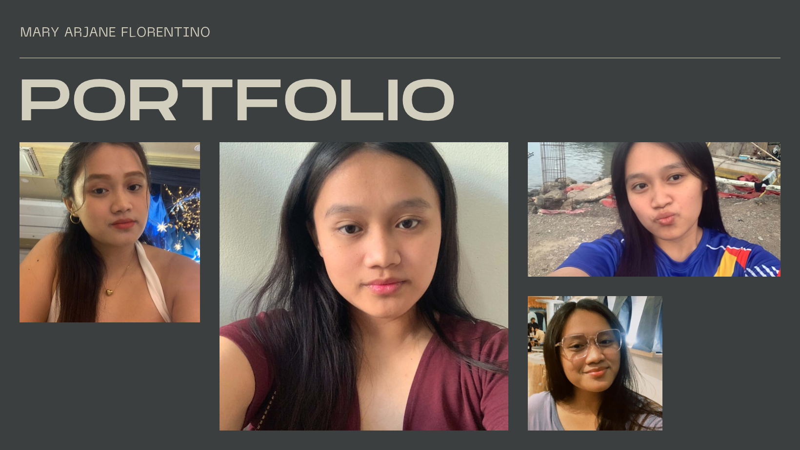
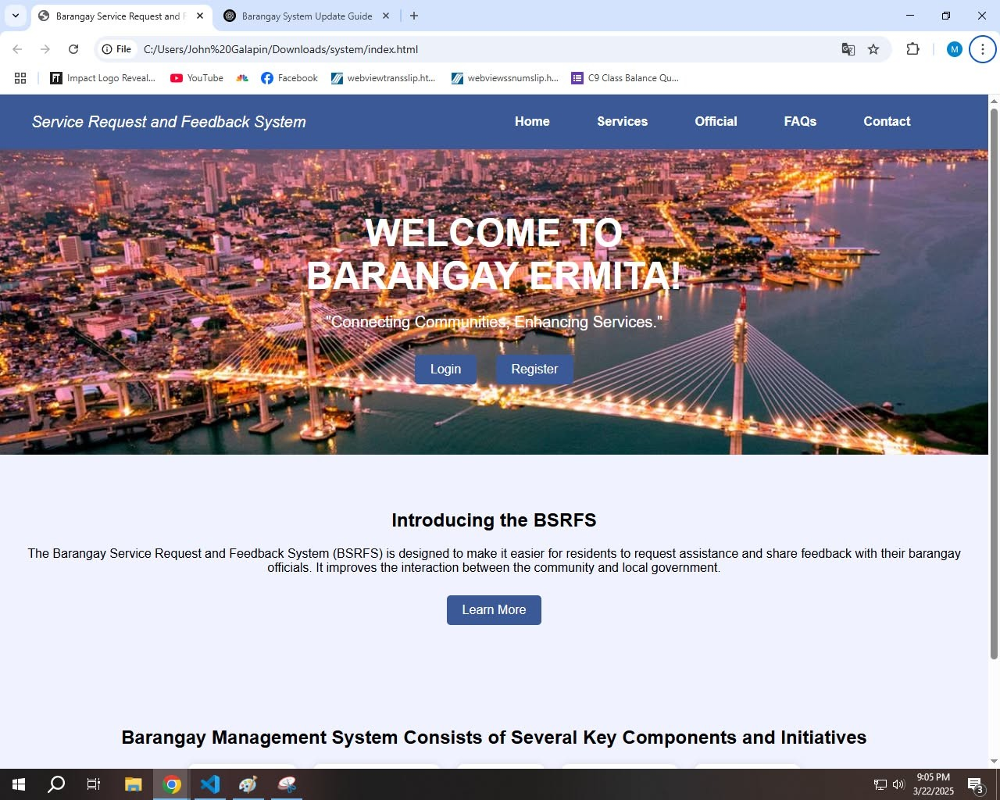
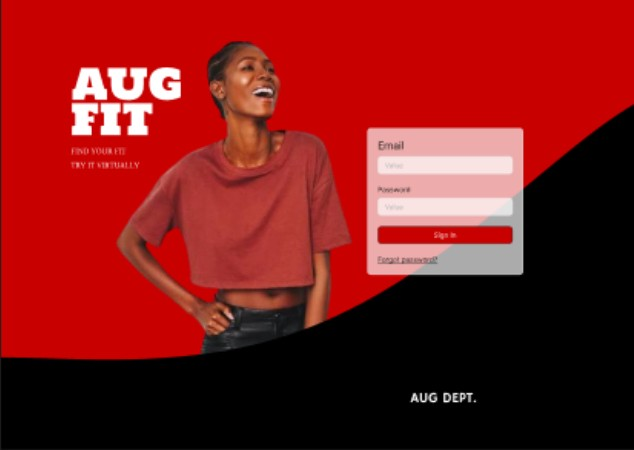

<!DOCTYPE html>
<html lang="en">
<head>
    <meta charset="UTF-8">
    <meta name="viewport" content="width=device-width, initial-scale=0.0">
    <title>ABOUT ME</title>
    <link rel="stylesheet" href="style.css">
</head>
<body>

    <!-- Header / Navbar -->
    <header class="navbar">
        

        
       <header class="main-header">
  

    
  

</header>
   
    <!-- Hero Section -->
    <section id="hero" class="hero-section">
        

            <h1>Hi, I'm Mary Arjane Florentino</h1>
            
I am a fourth year student dedicated to growing my expertise in marketing, brand communications, and creative design. Passionate about turning ideas into compelling visual assets and community-driven campaigns, I am looking to apply my skills and drive to real-world projects and internships.

    
        

    </section>

    <!-- Projects Section -->
    <section id="projects" class="projects-section">
        <h2>My Project</h2>
       <section id="project-details">
    
FIRST PROJECT

    
</section>
        

            <!-- Project Card 1 -->
            

                

                <h3>Baranggay Ermita Service Request and Feedback System</h3>
                
The Barangay Ermita Service Request and Feedback System is a digital platform designed to streamline and enhance communication between residents and their local barangay (village) authorities. It allows community members to submit service requests, such as reporting issues (e.g., road repairs, waste management, public safety concerns), requesting assistance (e.g., health services, permits), and providing feedback on the services they have received. I was assigned how the visuol or look of the system before coding.

            
    
SECOND PROJECT

    
                <H4>AUG FIT</H4>
            
AUG FIT is an AI-powered virtual try-on built for AUG DEPT. See how every piece looks and fits on your own body before you buy. Upload a photo, pick your size, and preview outfits in seconds, so you can shop with confidence, skip the guesswork, and cut down on returns.

            

            
            
    </section>

    <!-- Contact Section -->
    <section id="contact" class="contact-section">
        <h2>CONNECT WITH ME</h2>
        
I am avaialble anytime

        

            <a href="maryarjaneflorentino@gmail.com" class="contact-btn">maryarjaneflorentino@gmail.com</a>
        

    </section>

    <!-- Footer -->
    <footer>
        
0995-5843-1273

        
 &copy; 2026 Mary Arjane Florentino. All rights reserved.

    </footer>

</body>
</html>
